# Pahami Sehat

**"Informasi Kesehatan untuk Semua"**

Proyek untuk **LOGICODIX 2026 Hackathon** — subtema **Inclusive Health & Well-being**.
Masalah yang disasar: informasi kesehatan di Indonesia bukan langka, tapi sering tidak
sampai dan tidak dipahami oleh yang paling membutuhkan.

> Status: **MVP berjalan.** Fitur AI memanggil model sungguhan
> (`deepseek-v4-1-flash` lewat Kenari.id) dari server Express sendiri, dan
> setiap jawaban disertai sumber yang bisa dibuka pengguna.
>
> **Status tiap fitur — apa adanya:**
>
> | Fitur | Keadaan |
> |---|---|
> | Tanya AI + sumber | berjalan. Pencarian memakai kata kunci terpilih, bukan kalimat pengguna apa adanya |
> | Sederhanakan teks | berjalan (4 tingkat baca) |
> | Cek klaim | berjalan (verdict + sumber) |
> | Suara dibacakan | **BERJALAN sebagai suara neural Microsoft — di versi yang dijalankan di komputer sendiri; belum di versi daring.** Diukur 14 Okt 2026: `/api/suara` menjawab `200` berisi MP3 24 kHz untuk empat suara neural (Indonesia perempuan, Jawa, Sunda, Inggris); jawaban 39 kalimat (3.080 karakter) menghasilkan audio 1,4 MB dalam ~6 detik, dan isinya diperiksa dengan **transkripsi balik** (bukan hanya ukuran berkas) — terbaca kembali dengan keyakinan bahasa 1,00. Penyebab kegagalan lama sudah ditemukan: pustaka `msedge-tts` masih 2.0.9 dan **selalu** ditolak `403`; setelah dinaikkan ke `^2.1.0` suaranya berbunyi. **Jalur Kenari sudah DIBUANG** (keputusan jagi): saldo akun Rp 0, jadi setiap permintaan ditolak `402 insufficient_balance` atau menggantung 20 detik sebelum akhirnya pindah ke Microsoft — murni memperlambat. Layanan Microsoft membalas `429` kalau dihajar beruntun (terukur: 4 dari 8 permintaan lolos), jadi tiap kalimat sekarang **diulang sampai 4 kali** dengan jeda bertingkat; setelah itu 8/8 lolos. Di Vercel tetap `502` karena fungsi serverless tidak bisa mempertahankan WebSocket — batas platform, bukan bug. Rincian: `app/server/suara.js` |
> | Input suara (bicara) | berjalan lewat Web Speech API bawaan peramban. **Butuh Chrome atau Edge**: Brave memblokir layanan suara daring Google, dan Firefox belum menyediakannya |
> | Pindai foto / OCR | berjalan, **seluruhnya di peramban**. Foto tidak pernah dikirim ke server, dan fitur ini tetap jalan tanpa internet. Batasnya disebut apa adanya di aplikasi: alat bantu baca, bukan pengganti dokumen asli |
> | Riwayat pertanyaan | berjalan. Tersimpan di peramban saja (bukan server), maksimal **20 obrolan** (lihat `MAKS_SESI` di `app/src/lib/sesi.js`). Bisa **dihapus satu per satu atau sekaligus**, dan setiap penghapusan **bisa dibatalkan** |
> | Berita kesehatan harian | berjalan. Pertanyaan seperti "berita terbaru hari ini" dijawab dari **RSS** (Detik Health, WHO, Google News) — bukan dari ensiklopedia, karena Wikipedia tidak punya berita harian. Setiap berita disebutkan **nama medianya** dan **umurnya**, dan lonceng pemberitahuan berbunyi kalau ada berita segar (diperiksa maksimal sekali sehari). Di Vercel jalur ini jalan karena memakai HTTPS biasa, bukan WebSocket |
>
> Catatan operasional: endpoint yang memanggil layanan berbayar dibatasi
> 20 permintaan/menit per alamat IP (lihat `app/server/batas.js`).
> Pindai foto tidak masuk hitungan itu karena tidak menyentuh server sama sekali.

---

## Tampilan

Tangkapan layar di bawah diambil langsung dari aplikasi yang berjalan
(`npm run server`) — bukan gambar desain. Berkasnya ada di
[`docs/tangkapan-layar/`](docs/tangkapan-layar/). Yang terlihat di bagian
**Produk** adalah mockup perangkat, dan itu memang ilustrasi di dalam halaman —
sisanya tampilan sungguhan.

### Aplikasi — dashboard

| Beranda | Tanya AI | Cek Klaim |
|---|---|---|
| 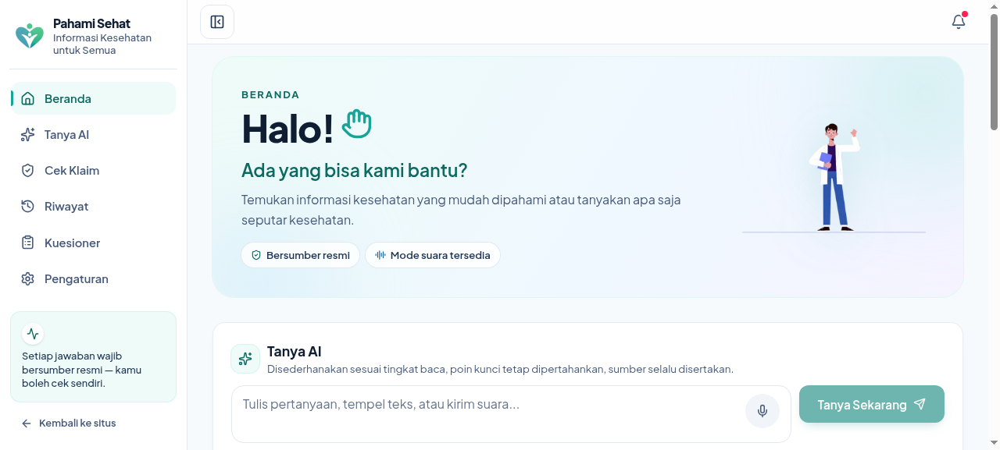 | 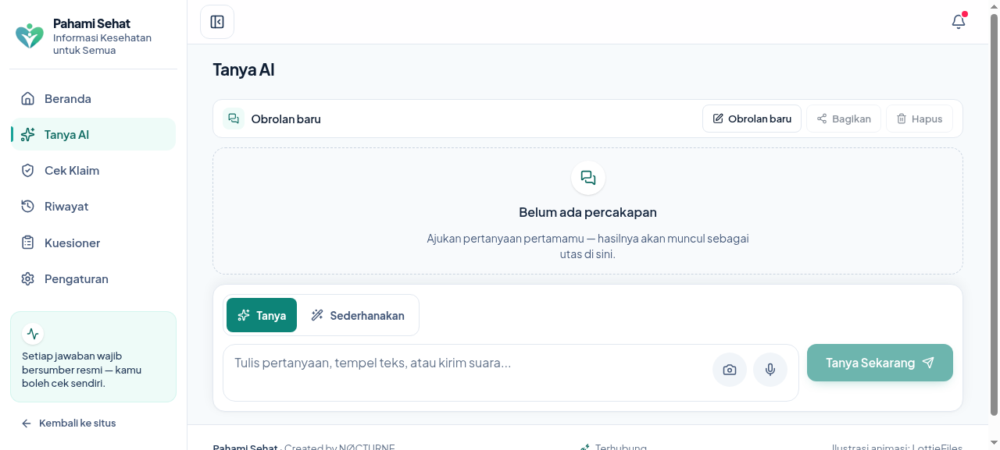 | 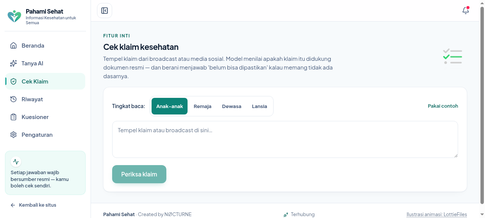 |

| Riwayat | Kuesioner | Pengaturan |
|---|---|---|
| 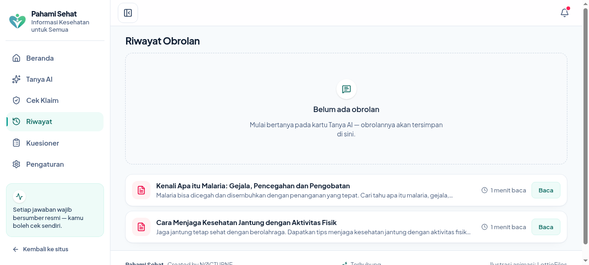 | 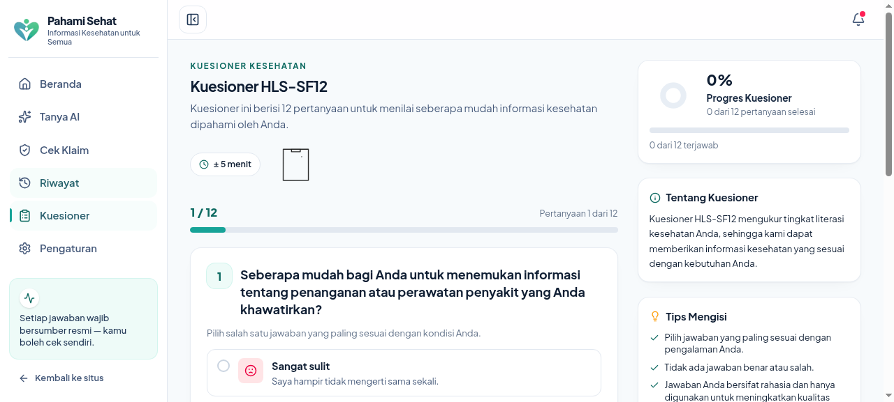 | 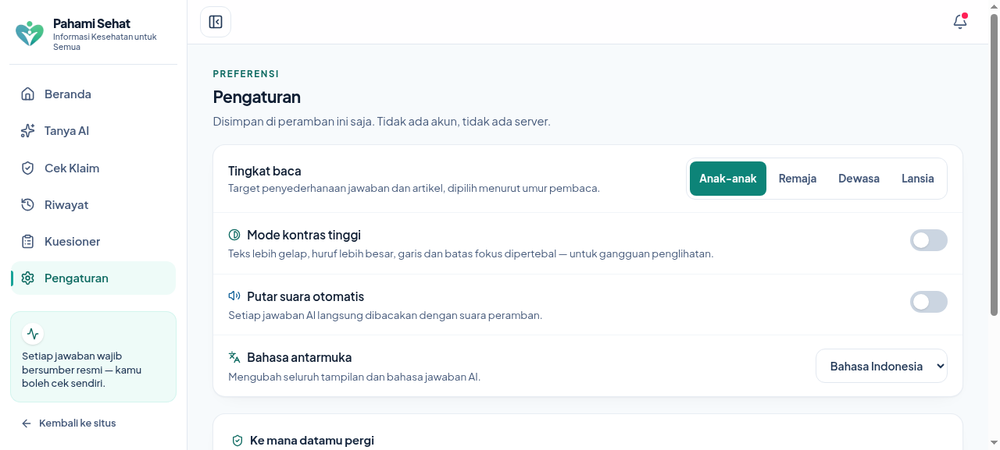 |

**Tampilan di ponsel** (lebar 390 px) — sidebar berubah jadi menu gulir:

| Beranda | Menu terbuka |
|---|---|
| 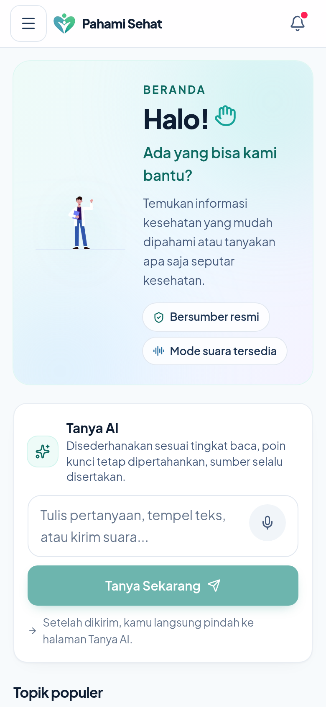 | 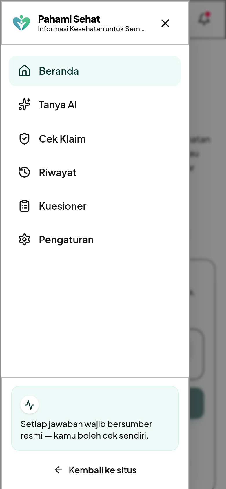 |

**Mode kontras tinggi** — satu sakelar: teks jadi hitam penuh, huruf dasar
membesar 112% (terukur 16 px → 17,92 px), garis dan batas fokus dipertebal:

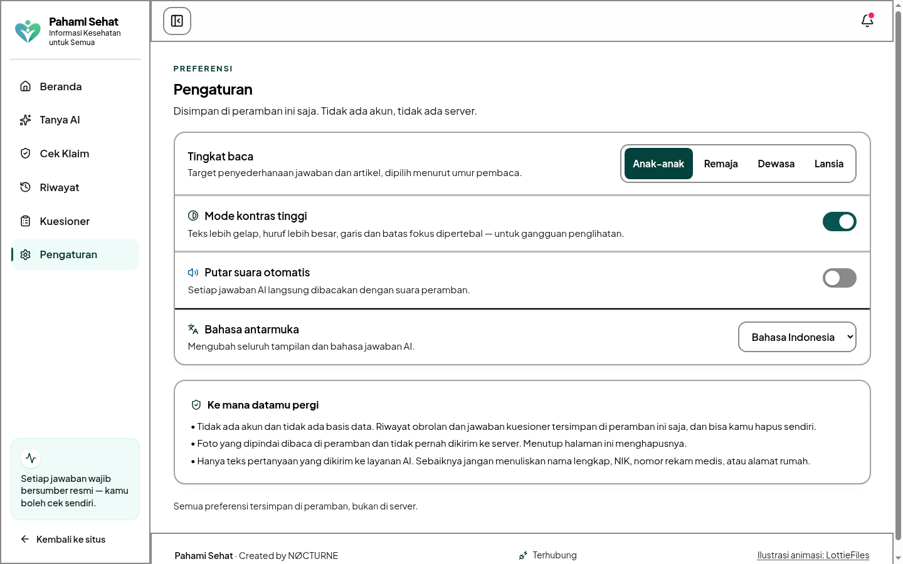

### Halaman penjelasan (prototype)

| Pembuka | Masalah & data | Konsep |
|---|---|---|
| 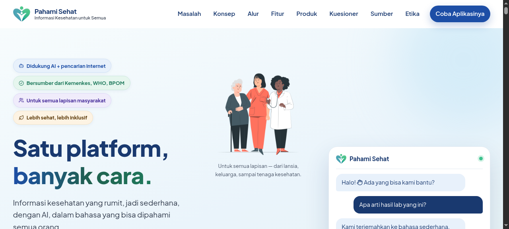 | 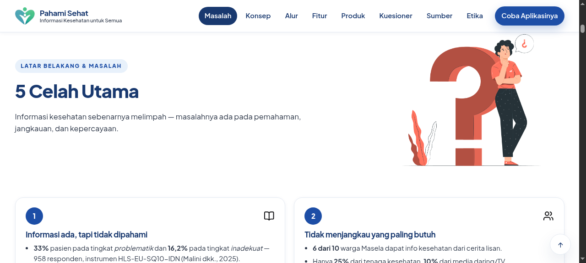 | 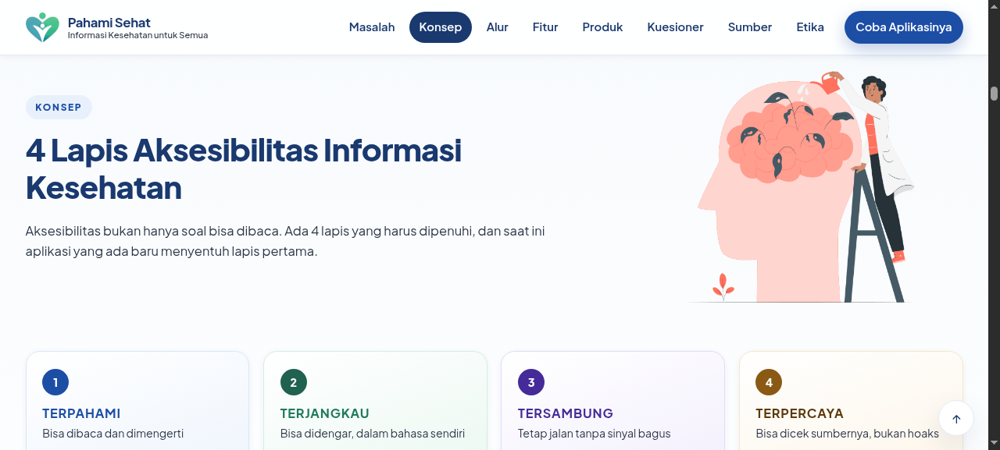 |

| Alur enam langkah | Lima fitur utama | Lanjutan fitur |
|---|---|---|
| 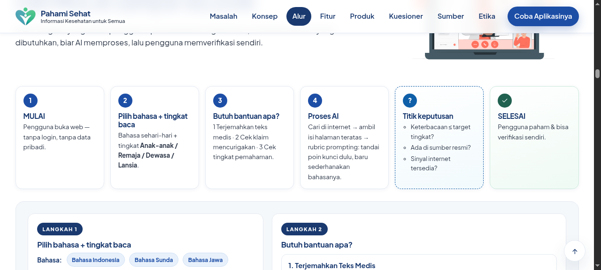 | 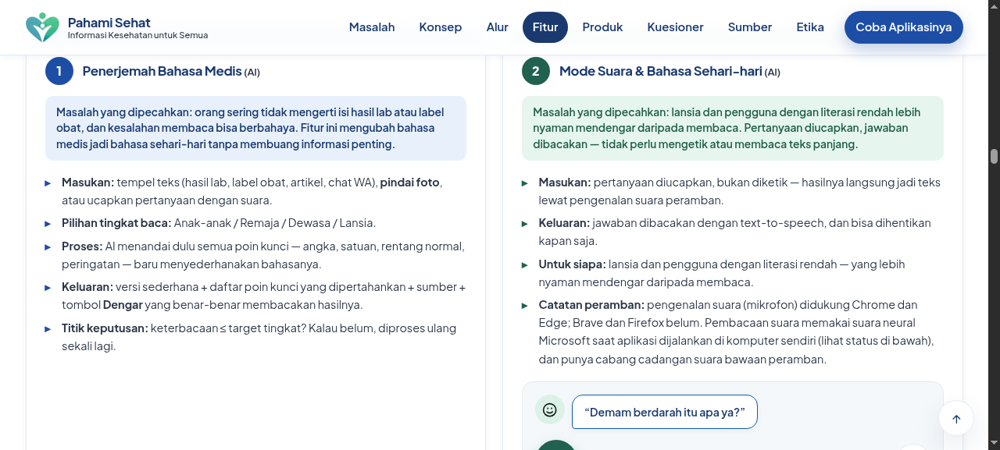 | 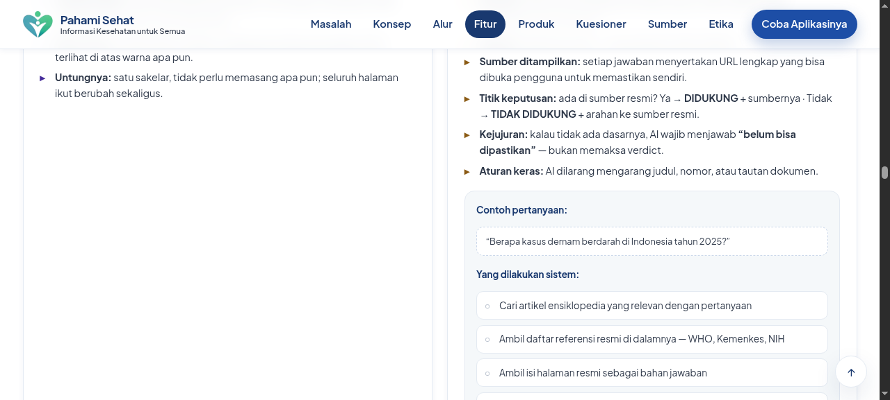 |

| Produk — mockup dasbor & ponsel | Kuesioner HLS-SF12 | Sumber & etika |
|---|---|---|
| 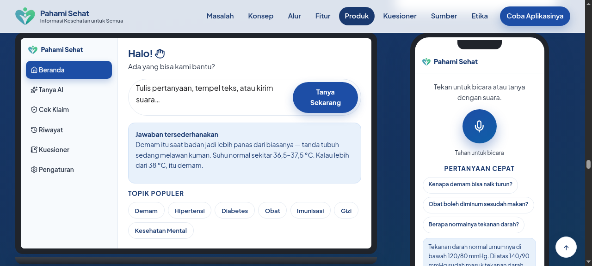 | 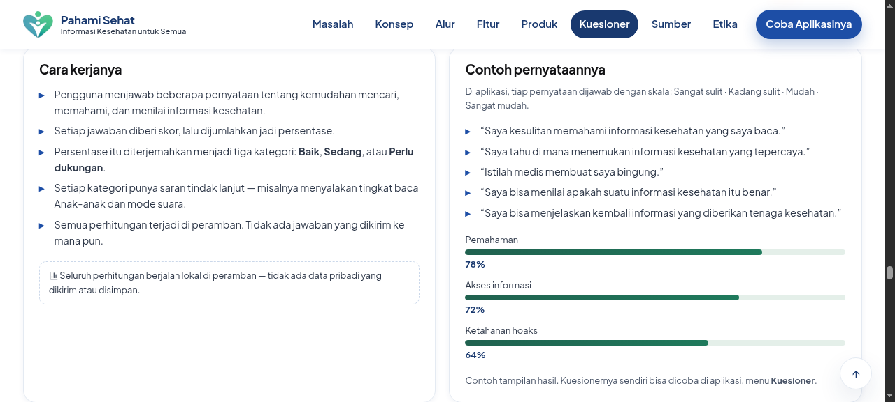 | 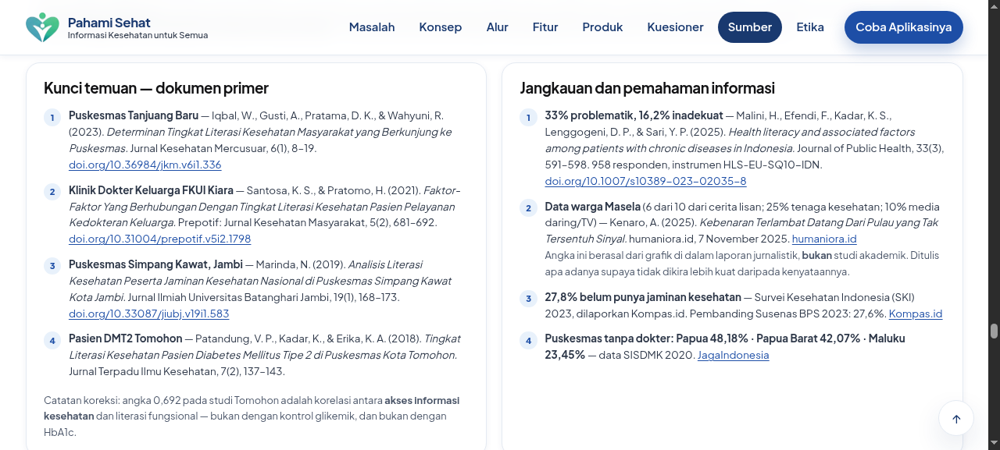 |

| Etika & keterbatasan | Prototype di ponsel | Bagian masalah di ponsel |
|---|---|---|
| 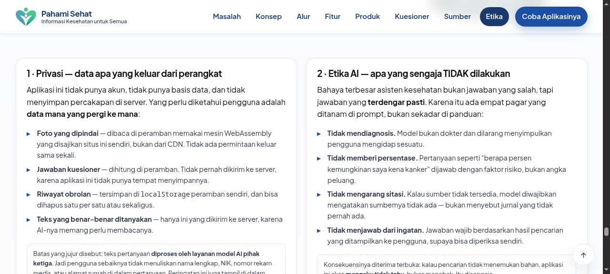 | 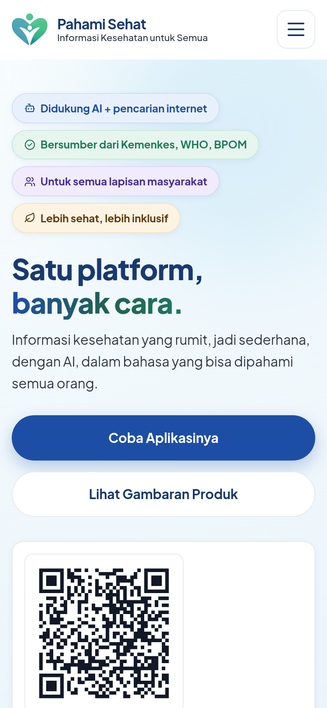 | 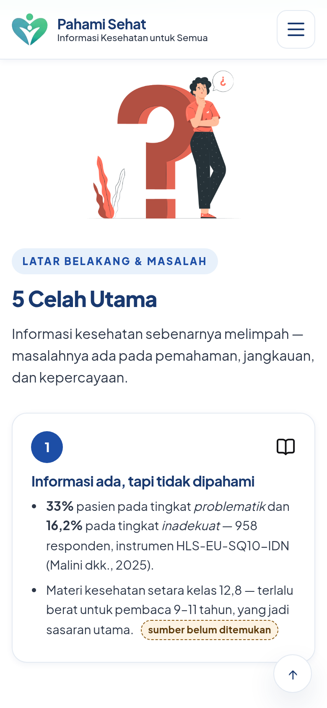 |

> Mockup perangkat di bagian **Produk** menampilkan **menu yang sama** dengan
> aplikasi sungguhan (Beranda, Tanya AI, Cek Klaim, Riwayat, Kuesioner,
> Pengaturan) — "Sederhanakan" dan "Suara" tidak berdiri sendiri karena
> keduanya sudah menjadi bagian dari Tanya AI.

---

## Peta folder

| Folder | Peran |
|---|---|
| [`app/`](app) | **Produk utama.** Aplikasi dashboard (React + Vite + Express). Ini yang dijalankan saat video demo dan Grand Final. |
| [`docs/prototipe/`](docs/prototipe) | **Halaman penjelasan** (HTML/CSS/JS statis): latar belakang, konsep 4 Lapis Aksesibilitas, alur pemakaian, status tiap fitur. **Tampil sebagai halaman depan situs.** |
| [`docs/tangkapan-layar/`](docs/tangkapan-layar) | **21 tangkapan layar** dashboard & prototype, diambil dari aplikasi yang berjalan (lihat bagian [Tampilan](#tampilan)). |
| [`docs/skema-database.sql`](docs/skema-database.sql) | **Skema MariaDB** — 9 tabel. Idempoten, aman dijalankan ulang. |
| [`panen-pengetahuan.mjs`](panen-pengetahuan.mjs) | **Pengisi database pengetahuan** — mengambil teks asli dari sumber resmi (bukan karangan AI). Lihat [Di mana datanya disimpan](#di-mana-datanya-disimpan). |
| [`docs/verifikasi-*.md`](docs) | **Berkas pendukung.** Laporan verifikasi setiap angka di bagian "Masalah" — memastikan klaimnya berasal dari dokumen yang bisa dibuka, bukan dari ingatan. Ringkasannya tampil di halaman penjelasan, bagian **Sumber Data**. |

### Sumber data di halaman penjelasan

Setiap angka di bagian **Latar Belakang & Masalah** diusahakan punya rujukan yang
bisa dibuka. Empat angka kunci ("Kunci Temuan") sudah dilacak sampai **PDF
dokumen primernya** — diunduh dan teks penuhnya diekstrak, bukan dari abstrak
pihak ketiga. Tiga angka yang belum ditemukan sumbernya **ditandai terbuka** di
halaman dengan label `perlu rujukan`, bukan dihapus diam-diam dan bukan
diklaim seolah ada sumbernya.

Verifikasi itu juga menemukan **dua kekeliruan** yang sudah dibetulkan:

| Dulu tertulis | Yang benar |
|---|---|
| Cakupan imunisasi "turun 95% → 80%" | 93,7% (2019) → 84,5% (2021). Angka 95% adalah **target** kekebalan kelompok, bukan capaian |
| Remaja 15–18 tahun "72% literasi rendah" | Dari responden yang berliterasi rendah, kelompok 15–18 tahun adalah **proporsi terbesar (72%)** — bukan 72% remaja berliterasi rendah |

Laporan lengkapnya ada di `docs/verifikasi-klaim-kesehatan.md` dan
`docs/verifikasi-studi-literasi-kesehatan.md`.

### Alamat di situs

| Alamat | Isi |
|---|---|
| `/` | halaman penjelasan — yang muncul pertama kali dibuka |
| `/app/` | aplikasi yang bisa dipakai |
| `/prototipe/` | salinan halaman penjelasan (tautan lama tetap hidup) |

```
pahami-sehat/
├── .github/workflows/uji.yml ← integrasi berkelanjutan (uji + build)
├── LICENSE                   ← MIT
├── README.md
├── uji-*.mjs                 ← uji tanpa jaringan (lihat "Menjalankan uji")
├── verifikasi-judul.mjs      ← buktikan judul artikel Wikipedia benar-benar ada
├── periksa-istilah.mjs       ← periksa calon istilah baru sebelum masuk peta
├── ukur-*.mjs                ← pengukuran untuk memilih angka batas
├── mermaid-diagram.png       ← sumber alur daur konten harian (dipakai konten.js)
├── app/                      ← PRODUK UTAMA (React + Express + Tailwind)
│   ├── .env                  API key Kenari (JANGAN di-commit)
│   ├── public/ocr/           mesin OCR: worker, core WASM, data bahasa
│   ├── server/               backend Express: route, klien Kenari, prompt, rubrik
│   ├── src/                  frontend React: App.jsx, lib/, data/, components/
│   ├── api/index.js          pintu masuk serverless Vercel
│   ├── index.html
│   ├── package.json
│   ├── vercel.json
│   └── vite.config.js
└── docs/
    ├── sumber-hls-sf12.txt   ← instrumen HLS-SF12 asli + teks Indonesia tervalidasi
    └── prototipe/            ← halaman penjelasan (statis, tanpa build)
        ├── index.html
        ├── css/
        ├── js/
        └── assets/
```

Dua bagian ini saling menaut: sidebar di `app/` punya tombol **"Kembali ke situs"**
ke halaman penjelasan, dan navbar `docs/prototipe/` punya tombol **"Coba Demo"**
ke aplikasi.

---

## Arsitektur

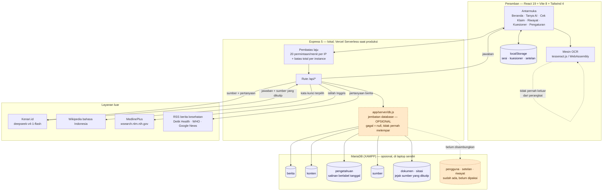

### Alur satu pertanyaan

1. **Peramban** mengirim pertanyaan ke `POST /api/tanya` (atau `/api/tanya/stream`
   untuk jawaban yang muncul bertahap).
2. **Pembatas laju** memeriksa jumlah permintaan dari alamat IP itu.
3. **Jalur berita** diperiksa lebih dulu (`menanyakanBerita()`). Pertanyaan
   seperti "berita terbaru hari ini" atau "latest health news today" tidak
   dijawab dari ensiklopedia — Wikipedia tidak punya berita harian. Pertanyaan
   itu dijawab dari **RSS** (Detik Health, WHO, Google News), dan setiap berita
   disebutkan beserta **nama medianya** dan **umurnya**. Di dalam aplikasi
   kesehatan, pertanyaan berita tidak perlu menyebut kata "kesehatan" — tetapi
   permintaan berita tentang topik yang jelas bukan kesehatan (politik, bola,
   ekonomi) ditolak dan dijawab sebagai obrolan biasa.
4. **Lapis pencarian** memilih **satu istilah** dari pertanyaan
   (`pilihIstilah()` di `app/server/kataKunci.js`). Nama penyakit selalu menang
   atas kata gejala; kata tindakan seperti `penyebab` atau `operasi` tidak pernah
   dipilih selama ada istilah yang lebih khusus.
5. Istilah itu dipetakan ke **dua bentuk berbeda**, karena dua mesin pencari
   memakai kosakata yang berbeda:
   - Wikipedia ID memakai **judul artikel kanonik** (`PETA_PENCARIAN`),
     mis. `stunting` → `Hambatan pertumbuhan`.
   - MedlinePlus memakai **istilah Inggris** (`PETA_MEDLINEPLUS`),
     mis. `rontgen` → `xrays`.
6. **Model AI** menerima pertanyaan + hasil pencarian, lalu menjawab **hanya**
   dari bahan itu. Prompt melarang menambah fakta dari ingatan.
7. Jawaban kembali bersama **sumber yang benar-benar dikutip**, dan panel
   `SumberJawaban` membedakan sumber yang **dipakai** dari yang cuma **ditemukan**.

### Di mana datanya disimpan

| Data | Tempat | Bertahan setelah halaman ditutup? |
|---|---|---|
| Sesi obrolan | `localStorage` (`pahami-sehat:sesi`) | ya, sampai dihapus pengguna |
| Jawaban kuesioner | `localStorage` (`pahami-sehat:kuesioner`) | ya |
| Setelan bahasa / tingkat baca / kontras | `localStorage` (`pahami-sehat:setelan`) | ya |
| Foto yang dipindai | **tidak disimpan ke mana pun** — dibaca di memori peramban | tidak |
| Pertanyaan & jawaban pengguna | **tidak disimpan** — bahkan dengan database menyala | tidak |

**Database bersifat OPSIONAL, dan itu dijaga di kode.** MariaDB (lewat XAMPP)
dipakai untuk menyimpan **bahan**, bukan percakapan pengguna. Kalau MariaDB
mati, aplikasi **tetap jalan** memakai berkas cache seperti sebelumnya —
`app/server/db.js` mengembalikan `null` alih-alih melempar galat.

Dibuktikan, bukan diklaim — dengan database dimatikan (`DB_MATI=1`):

| Yang diperiksa | Hasil |
|---|---|
| `GET /api/konten` | **HTTP 200** |
| `GET /api/berita/ringkas` | **HTTP 200** |
| `GET /api/tanya` | **HTTP 200**, jawaban tidak kosong |
| `GET /api/health` | melaporkan `{"aktif":false,"alasan":"dimatikan lewat DB_MATI=1"}` |

#### Yang disimpan di database

| Tabel | Isi | Padanan sebelumnya |
|---|---|---|
| `berita` | judul berita RSS, `sidik` UNIQUE mencegah duplikat | `.cache-berita.json` |
| `konten` | artikel & tips harian dari Kemenkes | `.cache-konten.json` |
| `pengetahuan` | **331 topik medis** dari sumber resmi, salinan berlabel tanggal | (baru) |
| `sumber` | 12 lembaga resmi (Kemenkes, WHO, BPOM, NIH, …) | (baru) |
| `dokumen` + `sitasi` | **jejak sumber yang dikutip** — klaim "jawaban ini dari WHO" jadi bisa **dilacak**, bukan cuma ditulis | (baru) |

Tabel `pengguna`, `setelan`, dan `riwayat` versi **LAMA** sudah dibuat di skema
tapi **belum disambungkan** ke jalur aplikasi dan tidak akan dipakai. Yang
aktif adalah `pengguna_baru`, `sesi`, dan `riwayat_pengguna` dari
`docs/skema-akun.sql` — dipakai oleh fitur akun (opsional: tanpa akun,
aplikasi tetap jalan penuh dan riwayat tinggal di peramban).

#### Jejak sitasi — cara memeriksanya

Setiap jawaban yang menyertakan sumber akan mencatatnya ke `dokumen` + `sitasi`,
**setelah** respons dikirim supaya pengguna tidak ikut menunggu. Untuk
memeriksa:

```bash
curl -s http://127.0.0.1:8787/api/sitasi
```

Yang dijaga:

- **Hanya URL `http(s)`** yang dicatat — sama seperti penyaring di
  `bentukHasil()`. `javascript:` dan `data:` ditolak, jadi model tidak bisa
  menyelipkan skema lain ke dalam tabel.
- **Anti-duplikat berdasarkan URL**: URL yang sama tidak menambah baris, hanya
  memperbarui tanggalnya. Kalau tidak dijaga, tabel membengkak satu baris
  setiap kali pengguna bertanya. (Kolom `url` panjangnya 700 karakter sehingga
  tidak bisa diberi `UNIQUE` langsung — pengecekannya dilakukan di kode.)
- **`kedaluwarsa` tetap ditegakkan** (30 hari untuk dokumen): baris yang sudah
  basi tidak ikut tersaji.
- **Pertanyaan pengguna tidak ikut disimpan** — endpoint `/api/sitasi` sengaja
  hanya menampilkan sumber mana dipakai untuk jenis jawaban apa, kapan.

Diuji `uji-sitasi.mjs` (**15 pemeriksaan**). Uji itu punya dua bagian: yang
**murni** (tanpa jaringan/database — aturan penolakan URL) dan yang
**terhubung** (butuh MariaDB). Kalau database mati, bagian kedua **dilewati
dengan pesan jelas dan exit 0** — bukan gagal, karena database memang opsional.

#### Satu aturan yang ditegakkan database sendiri

Setiap baris yang memuat informasi medis **wajib** punya kolom `kedaluwarsa`
(`NOT NULL`), dan penyajiannya selalu menyaring `WHERE kedaluwarsa > NOW()`.

```sql
INSERT INTO pengetahuan (topik, jenis, isi, sumber_id, url_sumber, diambil_pada)
VALUES ('uji','penyakit','x',1,'http://x',NOW());
-- ERROR 1364 (HY000): Field 'kedaluwarsa' doesn't have a default value
```

Alasannya bukan kerapian, tapi keselamatan: menyajikan panduan medis yang sudah
kadaluwarsa bukan bug teknis, itu risiko kesehatan. Baris yang basi **tidak
tersaji** — aplikasi harus mengambil ulang dari sumber resmi.

#### Asal 331 topik itu — dan kenapa bukan karangan AI

`panen-pengetahuan.mjs` **mengambil teks asli** dari sumber resmi, bukan
menyuruh model menulis dari ingatannya. Model bisa salah dosis atau mencampur
dua penyakit, dan kesalahan itu akan tersimpan rapi seolah fakta.

| Sumber | Baris | Ditandai |
|---|---|---|
| MedlinePlus (Perpustakaan Kedokteran Nasional AS, bagian NIH) | 270 | `resmi = 1` |
| Wikipedia bahasa Indonesia (pelengkap) | 61 | `resmi = 0` |

Setiap baris menyertakan `url_sumber` yang bisa diperiksa pengguna. Hasil akhir:
**331 baris, 0 kosong, 0 tanpa URL**, rata-rata 2.383 karakter, masa berlaku
90 hari. Tiga jebakan yang ditemukan dan ditutup: istilah Indonesia tidak
ditemukan di MedlinePlus (wajib lewat `PETA_MEDLINEPLUS`), salah tangkap topik
("luka" pernah tersimpan sebagai penjelasan cedera **bahu**), dan URL artikel
yang ternyata ada di **atribut** tag XML — kesalahan itu sempat membuat semua
tautan menunjuk halaman depan `medlineplus.gov`.

### Lima hal yang dijaga di sisi server

- **`app/server/kataKunci.js`** — pengenalan topik kesehatan. Satu daftar
  istilah dipakai bersama oleh `PENGENALAN_TOPIK`, `KATA_KESEHATAN`, dan kedua
  peta pencarian, supaya tidak ada istilah yang dikenali di satu jalur tapi mati
  di jalur lain.
- **`app/server/prompts.js`** — rubrik 7 butir. Butir 4 melarang mengarang
  sitasi, butir 5 dan 6 melarang memberi diagnosis/resep/dosis dan melarang
  menyimpulkan pengguna mengidap sesuatu.
- **`app/server/batas.js`** — pembatas laju. Penyimpanannya di memori proses,
  jadi di serverless batas ini **per-instance, bukan global** — cukup untuk
  menahan penyalahgunaan kasar, bukan jaminan global. Batasnya disebut apa
  adanya di komentar berkasnya.
- **`app/server/berita.js`** — jalur berita kesehatan. Parser RSS memperlakukan
  isi media sebagai **data**, bukan instruksi: judul/deskripsi yang menyuruh
  model mengabaikan aturan diabaikan, tag HTML dibuang, link wajib `http(s)`
  (menolak `javascript:` dan `data:`), satu feed dibatasi 30 item dan 2 MB, dan
  tanggal yang tidak sah diperlakukan seperti tanggal kosong — bukan `NaN` yang
  bocor ke pengurutan. Diuji `uji-berita.mjs` (89 pemeriksaan).
- **`app/server/db.js`** — jembatan database. Tiga hal yang tidak boleh
  dilanggar: (1) **tidak pernah melempar** — database mati harus menghasilkan
  `null`, bukan galat yang sampai ke pengguna; (2) setelah gagal, koneksi
  berikutnya ditunda 30 detik supaya setiap permintaan tidak ikut menunggu
  timeout; (3) penyajian data medis **selalu** menyaring
  `WHERE kedaluwarsa > NOW()`. Batasnya diakui: satu pool berisi 5 koneksi,
  tanpa kolam cadangan dan tanpa penyimpanan ulang otomatis.

### Jawaban kosong tidak boleh terjadi — dan cara membuktikannya

Diukur 15 Okt 2026: dua fitur pernah menjawab **KOSONG** — "berikan aku berita
terkini" dan Sederhanakan untuk teks medis panjang. Penyebabnya bukan prompt,
melainkan **jatah token**: model `deepseek-v4-1-flash` adalah model *reasoning*,
dan token `reasoning_content` yang ia hasilkan **ikut memakan `max_tokens`**.
Jawabannya belum sempat ditulis, jatahnya sudah habis (`finish_reason: length`),
JSON-nya terpotong, dan pengguna melihat gelembung hampa.

Tiga lapis perbaikan, semuanya terukur:

1. **Penalaran dimatikan** (`KENARI_REASONING_EFFORT=none`, lihat `config.js`).
   Pada pertanyaan yang sama dengan batas 120 token: dasar 48 token, `low` 21
   token, `none` **5 token** — jawaban yang dihasilkan sama persis. Setelah
   dimatikan, satu jawaban Sederhanakan turun dari >3400 token (terpotong)
   menjadi 474–985 token (utuh), dan seluruh gerbang keterbacaan tetap lulus.
2. **Anggaran token per jalur** (`MAKS_TOKEN` di `app/server/batasInput.js`),
   diukur satu per satu — bukan satu angka untuk semua jalur.
3. **Coba ulang + jawaban darurat.** Balasan yang tidak terbaca sebagai JSON
   diulang sekali; kalau tetap gagal, jalur berita menyusun jawabannya langsung
   dari daftar RSS (judul + media + umur, tanpa mengarang). Di antarmuka,
   jawaban kosong selalu diganti kalimat penjelasan — tidak pernah gelembung
   hampa.

Buktinya ada di uji, bukan di klaim: `uji-berita.mjs` bagian "jawaban darurat"
(12 pemeriksaan), bagian "uji jalur berita" di `uji-jawaban.mjs` (3 pertanyaan,
ikut menentukan exit code), dan `ukur-panjang.mjs` (batas kata per tingkat).

---

## Menjalankan aplikasi (produk utama)

Aplikasi punya dua bagian: frontend React dan backend Express yang memanggil model AI.

```bash
cd app
npm install --include=dev    # --include=dev WAJIB bila NODE_ENV=production

# 1) siapkan API key sekali saja
cp .env.example .env         # lalu isi KENARI_API_KEY=kn-...
chmod 600 .env

# 2) mode pengembangan (dua terminal)
npm run server               # backend  di http://127.0.0.1:8787
npm run dev                  # frontend Vite (otomatis meneruskan /api ke backend)

# 3) mode Grand Final — satu perintah, satu port
npm start                    # build + server di http://127.0.0.1:8787
```

### Database (opsional)

Aplikasi **jalan tanpa ini**. Kalau mau menyalakannya:

```bash
# XAMPP: pasang libxcrypt-compat DULU di Arch/CachyOS.
# Tanpa itu `xampp` gagal dengan pesan "only available as 32 bit application"
# yang MENYESATKAN — binernya 64-bit; akar masalahnya php butuh libcrypt.so.1.
sudo pacman -S libxcrypt-compat

sudo /opt/lampp/lampp startmysql          # MariaDB di port 3306
/opt/lampp/bin/mysql -u root < docs/skema-database.sql

# isi 331 topik medis dari sumber resmi (butuh ~10 menit)
node panen-pengetahuan.mjs --semua
```

Setel koneksinya lewat `.env` (bawaan sudah cocok untuk XAMPP):
`DB_HOST`, `DB_PORT`, `DB_USER`, `DB_PASSWORD`, `DB_NAMA`.
`DB_MATI=1` mematikan database sepenuhnya — dipakai untuk membuktikan aplikasi
tetap jalan tanpa itu.

Endpoint untuk memeriksa: `GET /api/health` (status db) dan `GET /api/db`
(hitungan + contoh baris, bukan seluruh isi tabel).

**Untuk Grand Final:** `npm start` adalah yang dipakai saat presentasi — Express
menyajikan hasil build sekaligus melayani `/api`, jadi cukup satu alamat.

> Hasil build memakai ES module, jadi membuka `dist/index.html` lewat `file://`
> **tidak akan jalan**. Harus disajikan lewat HTTP — `npm start` sudah begitu.

> Tanpa API key, server tidak mau start dan akan memberi pesan jelas soal `.env`.

## Melihat halaman penjelasan

```bash
cd docs/prototipe
python3 -m http.server 8080 --bind 127.0.0.1
# buka http://127.0.0.1:8080/
```

Halaman ini juga bisa dibuka langsung dari `index.html` di peramban (semua aset lokal).
Tombol "Coba Aplikasinya" mengarah ke `/app/`, jadi **build aplikasi dulu**
(`npm run build`) kalau ingin tombol itu berfungsi.

---

## Pindai foto (OCR) — seluruhnya di peramban

Fitur ini membaca teks dari foto (label obat, hasil lab, resep) memakai
`tesseract.js` (WebAssembly). **Tidak ada gambar yang dikirim ke server**, dan
fitur ini tetap bekerja tanpa internet maupun tanpa API key.

Mesinnya disajikan dari situs sendiri di `app/public/ocr/`, **bukan dari CDN**.
Itu pilihan yang disengaja: kalau berkasnya diambil dari CDN, pemindaian akan
mengirim permintaan ke pihak ketiga — dan janji "foto tidak keluar dari
perangkat" jadi tidak benar.

Isi `app/public/ocr/` (16,3 MB):

| Berkas | Asal |
|---|---|
| `worker.min.js` | paket `tesseract.js` |
| `tesseract-core-lstm.wasm.js`, `-simd-lstm`, `-relaxedsimd-lstm` | paket `tesseract.js-core` (tiga varian, dipilih sesuai dukungan peramban) |
| `langdata/ind.traineddata`, `langdata/eng.traineddata` | [tessdata_fast](https://github.com/tesseract-ocr/tessdata_fast) (Apache-2.0) |

Memperbarui berkas mesin (hanya kalau versi `tesseract.js` dinaikkan):

```bash
cd app
npm install tesseract.js@<versi>
cp node_modules/tesseract.js/dist/worker.min.js public/ocr/
cp node_modules/tesseract.js-core/tesseract-core-*-lstm.wasm.js public/ocr/
# data bahasa dari tessdata_fast (1,1 MB untuk ind, 3,9 MB untuk eng)
curl -sL -o public/ocr/langdata/ind.traineddata \
  https://github.com/tesseract-ocr/tessdata_fast/raw/main/ind.traineddata
curl -sL -o public/ocr/langdata/eng.traineddata \
  https://github.com/tesseract-ocr/tessdata_fast/raw/main/eng.traineddata
```

### Batas yang diakui terbuka

Diukur dengan tiga foto uji (dibuat dari teks asli, bukan gambar karangan), dan
ini ditulis apa adanya. Angka di bawah berasal dari **membandingkan hasil yang
benar-benar keluar dari aplikasi** dengan teks sumber yang diketahui — bukan dari
perkiraan:

| Foto uji | Akurasi huruf | Angka benar | Baris utuh | Angka yang salah |
|---|---|---|---|---|
| Label obat (teks besar) | 100,0% | 5/5 | 9/9 | — |
| Hasil lab (teks sedang) | 99,7% | 15/16 | 11/12 | `11.2` |
| Hasil lab (teks kecil) | 98,1% | 12/16 | 10/12 | `11.2`, `13.2`, `17.3`, `34` |

Kesalahannya **berpola sama dan sudah diketahui sebabnya**: tanda titik dua `:`
kadang terbaca sebagai angka `1`, sehingga `Hemoglobin : 11.2` menjadi
`111.2`. Diuji pada empat ukuran gambar berbeda (2000–3800 px) — **tidak ada
ukuran yang bebas dari kesalahan ini**. Pada teks kecil kesalahannya bertambah
karena hurufnya terlalu rapat untuk dipisahkan dengan yakin.

Karena itu:

- **Angka yang mencurigakan ditandai**, tidak dibetulkan sendiri. Menebak angka
  medis lebih berbahaya daripada tidak menebak.
- **Peringatan tegas selalu tampil**: ini alat bantu baca, angka hasil lab wajib
  dicocokkan ke kertas aslinya.
- **Keyakinan mesin bukan jaminan.** Pernah 84% tapi angkanya salah. Angka itu
  ditampilkan sebagai keterangan, bukan sebagai lampu hijau.
- **Tulisan tangan belum ditangani.** Resep yang ditulis tangan akan gagal.

Kesimpulan praktis: fitur ini andal untuk **label obat dan teks tercetak yang
jelas**, dan berguna tapi **belum bisa dipercaya sendiri untuk hasil lab** —
persis itulah yang dikatakan aplikasinya kepada pengguna.

### Menguji pindai foto

```bash
node uji-ocr.mjs        # 36 pemeriksaan: perapian teks & penandaan angka
```

Bagian yang butuh peramban sungguhan (mesin OCR-nya sendiri) diuji manual:
jalankan `npm start`, buka `/app/`, pilih menu **Pindai Foto**, masukkan foto
label obat atau hasil lab, lalu periksa bahwa teksnya muncul.

**Cara memeriksa "tanpa internet" yang benar.** Yang membuktikan janji
"foto tidak keluar dari perangkat" adalah uji blokir: halangi
`cdn.jsdelivr.net`, `unpkg.com`, `cdnjs.cloudflare.com`, dan
`raw.githubusercontent.com`, lalu pindai ulang — hasilnya harus sama. Uji itu
sudah dijalankan dan lulus (492 karakter, hasil identik).

Menonton tab Network saja **tidak cukup**, dan ini perlu disebut apa adanya:
tesseract.js memuat mesinnya di dalam Web Worker lewat `importScripts()`, dan
panggilan itu **tidak terekam** oleh perekam `fetch`/`XMLHttpRequest` maupun
oleh sebagian tampilan tab Network. Jadi "tab Network kosong" bukan bukti
yang sah untuk berkas yang diambil worker — walau di kasus ini memang tidak
ada permintaan ke luar, karena seluruh berkas disajikan dari
`app/public/ocr/` di situs sendiri.

### Menyetel mutu pembacaan

`app/src/lib/ocr.js` menyimpan angka-angka yang dipilih dari pengukuran, bukan
perkiraan. Kalau hasil pembacaan terasa memburuk, tiga hal ini yang pertama
diperiksa:

| Setelan | Nilai | Kenapa |
|---|---|---|
| `MAKS_SISI` / `MAKS_SISI_BESAR` | 2000 / 2600 px | huruf ~27 px benar untuk teks besar, ~35 px untuk teks kecil, ~44 px mulai salah |
| `TINGGI_HURUF_IDEAL` | 34 px | tinggi huruf yang mendekati keduanya |
| `AMBANG_RENTANG` | 110 | di bawah rentang kontras ini, perentangan kontras dipakai; di atasnya justru merusak (`11.2` jadi `21.2`) |

---

## Tingkat baca

Penyederhanaan teks memakai 4 tingkat, dengan target Flesch-grade (dikalibrasi ×0,6
untuk bahasa Indonesia):

| Tingkat | Target |
|---|---|
| Anak-anak | kelas 6 |
| Remaja | kelas 9 |
| Dewasa | kelas 12 |
| Lansia | kelas 8 |

Lansia ditargetkan **lebih sederhana** dari Dewasa karena Flesch-grade mengukur
kerumitan teks, bukan usia pembaca.

---

## Menjalankan uji

Semua uji di bawah ini berjalan tanpa jaringan dan tanpa API key, kecuali yang
ditandai. Jalankan dari akar repo:

```bash
node uji-batas.mjs        # batas panjang & laju tiap rute
node uji-ekstrak.mjs      # penarikan konten dari HTML sumber
node uji-kata-kunci.mjs   # pencocokan kata kunci topik
node uji-teks.mjs         # perapian teks & pemotongan kalimat
node uji-ocr.mjs          # 36 pemeriksaan: perapian teks & penandaan angka
node uji-bahasa.mjs       # 25 pemeriksaan: kesehatan kamus id/en
node uji-berita.mjs       # 89 pemeriksaan: deteksi berita, parser RSS, penetrasi
node uji-keterbacaan.mjs  # 38 pemeriksaan: alat ukur keterbacaan itu sendiri
node uji-suara.mjs        # 49 pemeriksaan: ejaan singkatan & kestabilan nada
node uji-sitasi.mjs       # 15 pemeriksaan: jejak sumber (butuh MariaDB)
node uji-akun.mjs         # 65 pemeriksaan: kata sandi, sesi, normalisasi (butuh MariaDB)
node uji-google.mjs       # 50 pemeriksaan: masuk dengan Google (tanpa jaringan)
node uji-server.mjs       # 24 pemeriksaan: kompresi, 404 JSON, galat klien
```

### Lapisan server — hal yang salahnya tidak terlihat dari build hijau

`uji-server.mjs` menguji empat hal yang **tidak merusak fitur apa pun** kalau
salah, sehingga tidak akan ketahuan dari uji fitur maupun build yang lulus:

| Yang dijaga | Kenapa penting |
|---|---|
| Respons besar dikompresi (gzip) | `/api/konten` **7.281 → 2.083 byte (hemat 71%)**. Tanpa ini aplikasi tetap jalan — hanya lambat di jaringan seluler. |
| JSON rusak dijawab **400**, bukan 500 | Kalau salah, kesalahan klien dilaporkan sebagai kesalahan server: pengguna disuruh "coba lagi" padahal isinya yang salah, dan pemantauan melihat 500 seolah server kita yang rusak. |
| `/api/*` tak dikenal → **JSON** | Bawaan Express membalas halaman HTML yang **menyebut "Express"** — memberitahu penyerang kerangka yang dipakai, sekaligus menyesatkan klien yang mengharap JSON. |
| `X-Waktu-Ms` di setiap respons | Menjawab "lambat di server atau di jaringan?" tanpa membuka log. Permintaan > 3 detik juga dicatat di log sebagai `[lambat]`. |

**Dua jebakan yang sudah terukur** (dan sebabnya uji ini ditulis):

1. `res.on('finish')` berjalan **setelah** header terkirim, jadi `setHeader` di
   dalamnya tidak berpengaruh — `X-Waktu-Ms` sempat tidak pernah muncul. Yang
   benar: hitung saat header AKAN dikirim (bungkus `res.writeHead`).
2. `fetch` bawaan Node **selalu** mengirim `Accept-Encoding: gzip` sendiri dan
   langsung men-dekompresi balasannya. Mengukur kompresi lewat `fetch`
   menghasilkan kesimpulan palsu ("tidak dikompresi", "ukurannya sama").
   Karena itu pengukuran kompresi memakai **HTTP mentah** (`node:http`).

`uji-suara.mjs` **tidak memanggil layanan suara** (tidak butuh jaringan), jadi
bisa ikut dijalankan di CI. Yang dijaganya: singkatan mana yang dieja dan mana
yang **tidak boleh** dieja — setiap anggota kedua kelompok diuji satu per satu,
sehingga menambah/mengurangi daftarnya tanpa mengukur ulang akan langsung gagal.

`uji-bahasa.mjs` menjaga tiga cacat kamus sekaligus: kunci yang dipakai tapi
tidak ada, kunci yang hanya ada di satu bahasa, dan kunci yang menganggur
(tidak dipakai siapa pun). Ketiganya pernah terjadi di proyek ini.

`uji-keterbacaan.mjs` menguji **alat ukurnya**, bukan jawabannya. Alat ukur yang
salah menghasilkan kesimpulan yang salah dengan sangat meyakinkan, jadi
penghitung suku katanya diuji dengan kata yang jumlahnya bisa dihitung manusia
("hipertensi" = 4, "pantai" = 2 karena diftong), dan daftar berbutir dipastikan
TIDAK dihitung sebagai satu kalimat raksasa.

`uji-sumber.mjs` juga berjalan tanpa jaringan (99 pemeriksaan). Versi
`--jaringan` menambahkan pemeriksaan bahwa setiap judul artikel Wikipedia yang
dipetakan benar-benar ada.

### Integrasi berkelanjutan

`.github/workflows/uji.yml` menjalankan seluruh uji di atas ditambah
`node --check` dan `npm run build` pada setiap push dan pull request ke `main`.

Dua hal yang **tidak** dijalankan di CI, dan alasannya disebut apa adanya:
`uji-jawaban.mjs` butuh `KENARI_API_KEY` (rahasia tidak boleh jadi penentu pada
pull request orang lain), dan uji berjaringan (`--jaringan`, `ukur-*`,
`verifikasi-judul.mjs`) bisa merah karena Wikipedia berubah, bukan karena kode
kita salah. Keduanya dijalankan manual sebelum deploy.

> **Catatan pemasangan di CI:** langkahnya memakai `npm ci --include=dev
> --ignore-scripts`. Flag `--ignore-scripts` wajib: `msedge-tts` memasang
> `preinstall: npx only-allow pnpm`, yang keluar dengan kode 1 bila dijalankan
> npm (diukur: exit 1 di bawah npm, exit 0 hanya di bawah pnpm). npm 11
> melewatkan install script secara bawaan sehingga ini tidak terasa di komputer
> pengembang, tetapi runner GitHub memakai npm 10 dan menjalankannya.
> Urutan langkah juga penting — dependensi dipasang lebih dulu, karena
> `uji-ocr.mjs` mengimpor `tesseract.js` lewat `app/src/lib/ocr.js`.

Dua skrip di bawah **butuh jaringan** dan hanya dipakai untuk memilih angka
batas dari pengukuran, bukan untuk rutin:

```bash
node ukur-konten.mjs      # berapa permintaan jaringan saat cache konten kosong
node ukur-suara.mjs       # berapa lama TTS benar-benar butuh (ini asal MAKS_SUARA)
```

### Mengukur & melatih tingkat pembaca

Tingkat baca (anak / remaja / dewasa / lansia) punya alat ukurnya sendiri.
"Latih" di sini **bukan fine-tuning** — Kenari tidak punya endpoint
fine-tuning (diperiksa: `/fine_tuning/jobs`, `/fine-tunes`, `/finetuning/jobs`,
`/models/train`, `/training/jobs` semuanya 404, dan tidak ada model berbau
training dari 105 yang tersedia). Latih = memperdalam prompt di
`app/server/prompts.js`, lalu **mengukur hasilnya dengan angka**:

```bash
node ukur-tingkat.mjs                 # 8 pertanyaan x 4 tingkat, butuh server lokal
node ukur-tingkat.mjs --cepat         # 3 pertanyaan saja
node ukur-kalibrasi.mjs docs/latih-tingkat-<cap>.json [--tulis]
```

`app/src/lib/keterbacaan.js` mengukur rata-rata kata/kalimat, suku kata/kata,
persentase kata sulit, dan kalimat terpanjang. **Bahasa Indonesia tidak punya
rumus keterbacaan resmi**, jadi modul itu tidak mengklaim "kelas baca" baku —
angkanya dipakai untuk membandingkan tingkat satu dengan lainnya.

`SASARAN` di modul itu adalah hasil **kalibrasi dari pengukuran nyata**, bukan
angka yang dikarang: `ukur-kalibrasi.mjs` menghitungnya dari hasil ukur +
kelonggaran, lalu memeriksa bahwa urutan antar tingkat tetap benar. Ambang
pertama yang ditulis dari perkiraan membuat 0 dari 8 jawaban lolos di semua
tingkat — ambang yang tidak bisa dicapai tidak berguna.

Yang diukur 14 Okt 2026 — rata-rata kata/kalimat dari 7 putaran pengukuran
(makin kecil makin mudah diikuti):

| | anak | lansia | remaja | dewasa |
|---|---|---|---|---|
| sebelum | 6,34 | 10,66 | 17,80 | 18,72 |
| sesudah | **6,01** | **6,68** | **7,34** | **10,37** |

Yang diuji bukan "apakah tangganya naik", melainkan **apakah jawaban tiap
tingkat lebih mudah daripada jawaban untuk DEWASA** — itu janji aplikasinya.
Diukur 8 putaran sebelum vs 7 putaran sesudah:

| hubungan wajib | kata/kalimat | kalimat terpanjang |
|---|---|---|
| anak < dewasa | 98,4% → **100,0%** | 95,2% → 96,4% |
| lansia < dewasa | 100,0% → 98,2% | 95,2% → 96,4% |
| remaja < dewasa | 82,0% → **94,6%** | 72,1% → **94,6%** |

Rantai penuh `anak <= lansia <= remaja <= dewasa` **sengaja tidak dipakai
sebagai syarat**: anak 9 tahun dan lansia 80 tahun sama-sama butuh bahasa
sederhana, dan "mana yang lebih sederhana" di antara keduanya tidak punya arti
bagi pengguna. Angkanya tetap dilaporkan.

Yang paling penting bukan angkanya, melainkan **isi tidak berkurang**: poin
kunci rata-rata anak 7,77 · lansia 7,34 · remaja 7,39 · dewasa 7,09. Sebelum
diperiksa, jawaban lansia justru punya poin kunci paling sedikit — batas kata
per kalimat dibaca model sebagai batas seluruh jawaban.

**Panjang kata tidak dipakai sebagai penilaian.** Kata yang paling sering dicap
"sulit" ternyata kata sehari-hari (adalah, karena, latihan, tekanan), dan
lantai normal prosa Indonesia adalah 31–46% kata ≥3 suku kata. Yang dipakai
sebagai gerbang hanya panjang kalimat. Alasan lengkapnya ada di
`app/src/lib/keterbacaan.js`.

**Satu putaran bukan bukti.** Dengan prompt yang sama, satu putaran memberi
`remaja < dewasa` 8/8 dan putaran berikutnya 5/8. Karena itu kesimpulan hanya
diambil dari agregasi beberapa putaran.

Yang **tidak** bisa diuji dari terminal — karena butuh peramban sungguhan —
diuji manual di `/app/`: mesin OCR, pengenalan suara, pemutaran suara, dan
tampilan mode Inggris.

---

## Etika, Privasi & Green IT

Tiga hal ini adalah **10% dari indikator penilaian LOGICODIX**, dan semuanya
adalah keadaan yang bisa diperiksa di kode — bukan janji di dokumen. Versi yang
ditulis untuk pembaca umum ada di halaman penjelasan, bagian **Privasi, Etika AI,
dan Jejaknya** (`docs/prototipe/index.html`, `id="etika"`).

### Privasi — apa yang keluar dari perangkat

| Data | Perjalanan |
|---|---|
| Foto yang dipindai | Dibaca di peramban (tesseract.js/WebAssembly dari `app/public/ocr/`, **bukan CDN**). Tidak ada permintaan keluar. |
| Jawaban kuesioner | Dihitung di peramban, disimpan di `localStorage`. Tidak pernah dikirim ke server. |
| Riwayat obrolan | `localStorage` peramban. Bisa dihapus satu per satu atau sekaligus. |
| Teks pertanyaan | **Hanya ini** yang dikirim ke server, karena model AI memang perlu membacanya. |

Batas yang jujur disebut: teks pertanyaan diproses oleh **layanan model AI pihak
ketiga** (Kenari.id). Karena itu aplikasi memperingatkan pengguna agar tidak
menuliskan nama lengkap, NIK, nomor rekam medis, atau alamat rumah — peringatan
itu tampil di panel **Pengaturan** (`set.privasi1..3` di `app/src/data/bahasa.js`).

**Ada akun, tetapi opsional.** Aplikasi ini tetap bisa dipakai tanpa masuk —
tanpa akun, semuanya jalan seperti sebelumnya dan riwayat obrolan tinggal di
peramban. Akun baru diperlukan kalau riwayat ingin ikut lintas perangkat.

Kalau pengguna memilih punya akun, yang disimpan **hanya**: email ATAU nomor
telepon, nama panggilan, hash kata sandi (scrypt + salt, tidak pernah kata
sandinya), `google_id` kalau masuk lewat Google, dan riwayat obrolan miliknya
sendiri. **Tidak ada** nama lengkap, NIK, tanggal lahir, alamat, atau foto —
aplikasi ini bahkan memperingatkan pengguna agar tidak menuliskan data seperti
itu di pertanyaan, jadi menyimpannya di akun akan bertentangan dengan
peringatan sendiri. Isi percakapan tidak pernah dipakai untuk analitik.

Bahan publik (berita RSS, artikel Kemenkes, salinan berlabel tanggal dari
sumber resmi) tetap tersimpan terpisah dari akun. Tabel `pengguna`, `setelan`,
dan `riwayat` versi **lama** di `skema-database.sql` masih ada tapi tidak
dipakai — yang aktif adalah `pengguna_baru`, `sesi`, dan `riwayat_pengguna`
dari `docs/skema-akun.sql`.

Masuk dengan Google memakai alur **server-side**: client secret hanya hidup di
server, dan `state` diperiksa supaya alur ini tidak bisa dibajak (login CSRF).
Rinciannya — termasuk kenapa akun hanya ditautkan kalau email Google-nya
terverifikasi — ada di `app/server/google.js` dan diuji oleh `uji-google.mjs`.

Yang ditulis ke disk: `.cache-konten.json` dan `.cache-berita.json` (berlaku
24 jam), plus tabel-tabel di atas bila MariaDB dijalankan.

### Etika AI — pagar yang ditanam di prompt

Lima larangan ini ada di `app/server/prompts.js` (`RUBRIK`, butir 4–6) dan
diuji oleh `uji-jawaban.mjs`, bukan sekadar dijanjikan di README:

1. **Tidak mendiagnosis** — butir 5: model bukan dokter, dilarang memberi
   diagnosis, resep, atau dosis.
2. **Tidak menyimpulkan pengguna mengidap sesuatu** — butir 6: pertanyaan
   "apakah saya kena X" dijawab faktor risiko sebagai fakta umum, bukan penilaian
   atas diri pengguna, dan dilarang menyusun daftar kemungkinan penyakit yang
   bersaing.
3. **Tidak memberi persentase** yang tidak ada di sumber.
4. **Tidak mengarang sitasi** — butir 4: kalau sumber tidak tersedia, model
   wajib menyatakan sumbernya belum bisa dipastikan.
5. **Tidak menjawab dari ingatan** — prompt berbunyi *"Jawab HANYA berdasarkan
   hasil pencarian di atas. Jangan menambah fakta dari ingatanmu."*

Konsekuensinya diterima terbuka: kalau pencarian tidak menemukan bahan, aplikasi
akan **mengaku tidak tahu**. Itu disengaja — aplikasi kesehatan yang menebak
lebih berbahaya daripada yang mengaku tidak tahu.

### Green IT — jejak sumber daya

Prinsip: **jangan panggil jaringan kalau hasilnya bisa dipakai ulang.**

| Kendali | Di mana | Angka |
|---|---|---|
| Cache konten kesehatan | `app/server/konten.js` (`BERLAKU_MS`) | 24 jam sekali sehari |
| Batas pengambilan artikel | `app/server/konten.js` (`MAKS_DETAIL`) | 8, dari yang tadinya bisa sampai 40 |
| Pembatas laju per IP | `app/server/batas.js` | 20 permintaan/menit |
| Cache aset ber-hash | `app/vercel.json` | 1 tahun, `immutable` |
| Cache berkas ber-nama-tetap | `app/vercel.json` (`/app/ocr/`) | 1 hari + `stale-while-revalidate` |
| Pemindaian foto | `app/src/lib/ocr.js` | 0 permintaan server |

**Yang belum selesai, disebut apa adanya:**

- Pembatas laju disimpan di **memori proses**, jadi di lingkungan serverless
  batasnya berlaku **per-instance, bukan global**. Untuk batas yang benar-benar
  global diperlukan penyimpanan bersama (mis. Redis/Upstash) — belum dipasang.
- Aplikasi ini **belum mengukur emisi karbonnya sendiri**, jadi tidak ada angka
  jejak karbon yang diklaim di mana pun.
- Belum ada halaman kebijakan privasi tersendiri dan alamat kontak resmi untuk
  permintaan penghapusan data.

### Kepatuhan UU PDP No. 27/2022 dalam praktik

| Prinsip | Keadaan |
|---|---|
| Minimalisasi data | Yang diambil hanya teks pertanyaan. Tidak ada nama lengkap, NIK, atau alamat yang diminta. Akun (opsional) menyimpan hanya email/telepon, nama panggilan, dan hash kata sandi. |
| Kendali di tangan subjek data | Riwayat dan jawaban kuesioner disimpan di perangkat pengguna dan bisa dihapus pengguna kapan saja. |
| Keterbukaan | Perpindahan data dijelaskan sebelum pengguna memakainya (panel Pengaturan), bukan disembunyikan. |
| Hak penghapusan | Terpenuhi secara teknis (tombol hapus riwayat), **belum** terpenuhi secara prosedural (belum ada kanal kontak resmi). |

---

## Konteks lomba (LOGICODIX 2026)

Indikator penilaian: Problem-Solution Fit 25% · Technology Innovation 25% ·
Software Engineering 25% · UI/UX 15% · Green IT & Ethics 10%.

Tenggat: Hacking Week 7–14 November 2026 · **Last Submission 14 November 2026** ·
Pengumuman finalis 21 November 2026 · Puncak acara 29 November 2026.

Ketentuan yang mengikat: karya MVP berbasis Web/Mobile, source code di repo GitHub,
video demo 3–5 menit **tanpa narasi peserta**, dan aplikasi harus bisa dijalankan
di localhost saat Grand Final.

---

## Membuka aplikasi ke internet, tapi tetap berjalan di laptop sendiri

Aplikasi ini dirancang berjalan di komputer sendiri: satu server Express menyajikan
halaman penjelasan (`/`) dan aplikasi (`/app/`), dan fitur suara neural memakai
WebSocket yang tidak bisa hidup di fungsi serverless. Yang kurang hanya satu: orang
lain tidak bisa membukanya.

**Cloudflare Tunnel** menutup celah itu tanpa membuka port di router dan tanpa
menyewa server:

```bash
./jalankan-online.sh
```

Skrip itu membangun aplikasi, menjalankan server, membuka terowongan, lalu mencetak
alamat `https://….trycloudflare.com` yang bisa dibuka siapa saja. Berhenti dengan
**Ctrl+C** — keduanya ikut berhenti.

### Kenapa ini lebih baik daripada sekadar `http://<ip-lan>`

| | `http://192.168.x.x:8787` | Terowongan Cloudflare |
|---|---|---|
| Bisa dibuka dari luar jaringan | tidak | ya |
| HTTPS | tidak | **ya** |
| Pengenalan suara (mikrofon) | **tidak** — peramban memblokir mikrofon di halaman http | ya |
| Suara neural (TTS) | ya | ya |
| Port terbuka di router | perlu | **tidak** |
| Alamat tetap | ya | berubah tiap dijalankan |

Peramban hanya mengizinkan mikrofon dan papan klip di **konteks aman** — `https://`
atau `localhost`. Diukur 15 Okt 2026: lewat terowongan, `window.isSecureContext`
bernilai `true`, `SpeechRecognition` dan `mediaDevices` tersedia, dan `/api/suara`
menjawab `200` berisi MP3 24 kHz — hal yang tidak bisa dilakukan lewat alamat IP biasa.

### Batasnya, disebut apa adanya

- Alamatnya **hidup hanya selama skrip jalan dan mesin ini menyala**. Tidak ada
  uptime yang dijanjikan, dan terowongan tanpa akun Cloudflare memang tanpa jaminan.
- Alamat `trycloudflare.com` **berubah setiap kali dijalankan**. Kalau butuh alamat
  tetap (mis. untuk dinilai juri), pakai *named tunnel* dengan akun Cloudflare —
  itu di luar cakupan skrip ini.
- Server tetap hanya mendengarkan di `127.0.0.1`; yang menghubungkannya ke internet
  hanyalah `cloudflared`. Jadi tidak ada port yang terbuka ke jaringan lokal.
- Terowongan ini membuka aplikasi ke publik. Batas laju di `app/server/batas.js`
  tetap berlaku, tetapi tidak ada autentikasi — jangan dipakai untuk data pribadi.

### Memakai nama domain sendiri (alamat tetap)

Quick tunnel menghasilkan alamat acak yang **berubah setiap dijalankan**. Kalau butuh
alamat tetap — mis. agar juri bisa membuka URL yang sama tanpa dikirim ulang — pakai
**named tunnel**. Syaratnya hanya **punya domain**, bukan langganan berbayar: dokumentasi
Cloudflare menyebut "a Cloudflare account" dan "a domain on Cloudflare", keduanya gratis.

Sekali saja:

```bash
./siapkan-domain.sh pahami-sehat.id
```

Skrip itu memandu login Cloudflare, membuat tunnel bernama `pahami-sehat`, memetakan
hostname ke `http://127.0.0.1:8787`, lalu menulis `~/.cloudflared/config.yml`.
Setelah itu cukup:

```bash
./jalankan-online.sh      # otomatis memakai named tunnel kalau config.yml ada
```

`jalankan-online.sh` memilih sendiri: **ada `~/.cloudflared/config.yml` → alamat tetap**;
tidak ada → quick tunnel seperti biasa. Jadi menambah domain tidak merusak cara lama.

| | Quick tunnel | Named tunnel |
|---|---|---|
| Alamat | acak, berubah tiap dijalankan | **tetap** (`https://pahami-sehat.id`) |
| Butuh domain | tidak | ya |
| Batas 200 permintaan bersamaan | ya | **tidak ada** |
| Sertifikat HTTPS | otomatis | otomatis |

Yang tetap berlaku di keduanya: alamatnya hidup hanya selama skrip jalan dan mesin ini
menyala, dan tidak ada autentikasi — jangan dipakai untuk data pribadi.
