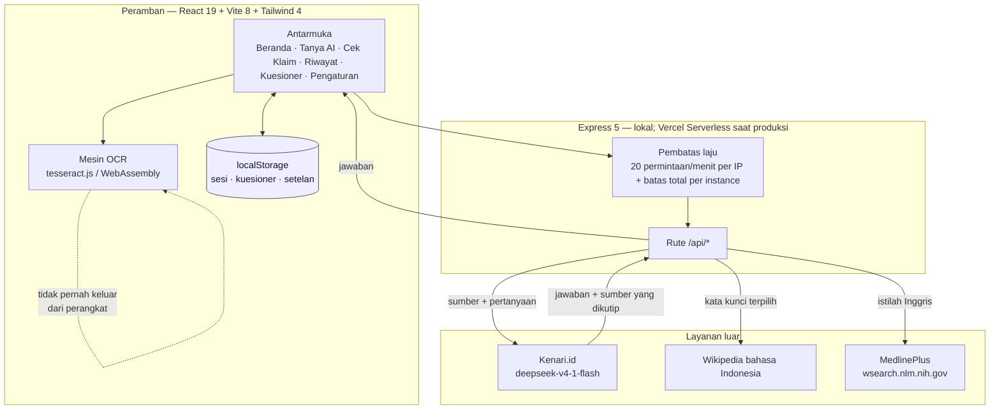

# Pahami Sehat

**"Informasi Kesehatan untuk Semua"**

Proyek untuk **LOGICODIX 2026 Hackathon** — subtema **Inclusive Health & Well-being**.
Masalah yang disasar: informasi kesehatan di Indonesia bukan langka, tapi sering tidak
sampai dan tidak dipahami oleh yang paling membutuhkan.

> Status: **MVP berjalan.** Fitur AI memanggil model sungguhan
> (`deepseek-v4-1-flash` lewat Kenari.id) dari server Express sendiri, dan
> setiap jawaban disertai sumber yang bisa dibuka pengguna.
>
> **Status tiap fitur — apa adanya:**
>
> | Fitur | Keadaan |
> |---|---|
> | Tanya AI + sumber | berjalan. Pencarian memakai kata kunci terpilih, bukan kalimat pengguna apa adanya |
> | Sederhanakan teks | berjalan (4 tingkat baca) |
> | Cek klaim | berjalan (verdict + sumber) |
> | Suara dibacakan | berjalan — suara neural, nada mengikuti isi kalimat |
> | Input suara (bicara) | berjalan lewat Web Speech API bawaan peramban. **Butuh Chrome atau Edge**: Brave memblokir layanan suara daring Google, dan Firefox belum menyediakannya |
> | Pindai foto / OCR | berjalan, **seluruhnya di peramban**. Foto tidak pernah dikirim ke server, dan fitur ini tetap jalan tanpa internet. Batasnya disebut apa adanya di aplikasi: alat bantu baca, bukan pengganti dokumen asli |
> | Riwayat pertanyaan | berjalan. Tersimpan di peramban saja (bukan server), maksimal 12 entri. Bisa **dihapus satu per satu atau sekaligus**, dan setiap penghapusan **bisa dibatalkan** |
>
> Catatan operasional: endpoint yang memanggil layanan berbayar dibatasi
> 20 permintaan/menit per alamat IP (lihat `app/server/batas.js`).
> Pindai foto tidak masuk hitungan itu karena tidak menyentuh server sama sekali.

---

## Peta folder

| Folder | Peran |
|---|---|
| [`app/`](app) | **Produk utama.** Aplikasi dashboard (React + Vite + Express). Ini yang dijalankan saat video demo dan Grand Final. |
| [`docs/prototipe/`](docs/prototipe) | **Halaman penjelasan** (HTML/CSS/JS statis): latar belakang, konsep 4 Lapis Aksesibilitas, alur pemakaian, status tiap fitur. **Tampil sebagai halaman depan situs.** |
| [`docs/verifikasi-*.md`](docs) | **Berkas pendukung.** Laporan verifikasi setiap angka di bagian "Masalah" — memastikan klaimnya berasal dari dokumen yang bisa dibuka, bukan dari ingatan. Ringkasannya tampil di halaman penjelasan, bagian **Sumber Data**. |

### Sumber data di halaman penjelasan

Setiap angka di bagian **Latar Belakang & Masalah** diusahakan punya rujukan yang
bisa dibuka. Empat angka kunci ("Kunci Temuan") sudah dilacak sampai **PDF
dokumen primernya** — diunduh dan teks penuhnya diekstrak, bukan dari abstrak
pihak ketiga. Tiga angka yang belum ditemukan sumbernya **ditandai terbuka** di
halaman dengan label `perlu rujukan`, bukan dihapus diam-diam dan bukan
diklaim seolah ada sumbernya.

Verifikasi itu juga menemukan **dua kekeliruan** yang sudah dibetulkan:

| Dulu tertulis | Yang benar |
|---|---|
| Cakupan imunisasi "turun 95% → 80%" | 93,7% (2019) → 84,5% (2021). Angka 95% adalah **target** kekebalan kelompok, bukan capaian |
| Remaja 15–18 tahun "72% literasi rendah" | Dari responden yang berliterasi rendah, kelompok 15–18 tahun adalah **proporsi terbesar (72%)** — bukan 72% remaja berliterasi rendah |

Laporan lengkapnya ada di `docs/verifikasi-klaim-kesehatan.md` dan
`docs/verifikasi-studi-literasi-kesehatan.md`.

### Alamat di situs

| Alamat | Isi |
|---|---|
| `/` | halaman penjelasan — yang muncul pertama kali dibuka |
| `/app/` | aplikasi yang bisa dipakai |
| `/prototipe/` | salinan halaman penjelasan (tautan lama tetap hidup) |

```
pahami-sehat/
├── .github/workflows/uji.yml ← integrasi berkelanjutan (uji + build)
├── LICENSE                   ← MIT
├── README.md
├── uji-*.mjs                 ← uji tanpa jaringan (lihat "Menjalankan uji")
├── verifikasi-judul.mjs      ← buktikan judul artikel Wikipedia benar-benar ada
├── periksa-istilah.mjs       ← periksa calon istilah baru sebelum masuk peta
├── ukur-*.mjs                ← pengukuran untuk memilih angka batas
├── mermaid-diagram.png       ← sumber alur daur konten harian (dipakai konten.js)
├── app/                      ← PRODUK UTAMA (React + Express + Tailwind)
│   ├── .env                  API key Kenari (JANGAN di-commit)
│   ├── public/ocr/           mesin OCR: worker, core WASM, data bahasa
│   ├── server/               backend Express: route, klien Kenari, prompt, rubrik
│   ├── src/                  frontend React: App.jsx, lib/, data/, components/
│   ├── api/index.js          pintu masuk serverless Vercel
│   ├── index.html
│   ├── package.json
│   ├── vercel.json
│   └── vite.config.js
└── docs/
    ├── sumber-hls-sf12.txt   ← instrumen HLS-SF12 asli + teks Indonesia tervalidasi
    └── prototipe/            ← halaman penjelasan (statis, tanpa build)
        ├── index.html
        ├── css/
        ├── js/
        └── assets/
```

Dua bagian ini saling menaut: sidebar di `app/` punya tombol **"Kembali ke situs"**
ke halaman penjelasan, dan navbar `docs/prototipe/` punya tombol **"Coba Demo"**
ke aplikasi.

---

## Arsitektur



### Alur satu pertanyaan

1. **Peramban** mengirim pertanyaan ke `POST /api/tanya` (atau `/api/tanya/stream`
   untuk jawaban yang muncul bertahap).
2. **Pembatas laju** memeriksa jumlah permintaan dari alamat IP itu.
3. **Lapis pencarian** memilih **satu istilah** dari pertanyaan
   (`pilihIstilah()` di `app/server/kataKunci.js`). Nama penyakit selalu menang
   atas kata gejala; kata tindakan seperti `penyebab` atau `operasi` tidak pernah
   dipilih selama ada istilah yang lebih khusus.
4. Istilah itu dipetakan ke **dua bentuk berbeda**, karena dua mesin pencari
   memakai kosakata yang berbeda:
   - Wikipedia ID memakai **judul artikel kanonik** (`PETA_PENCARIAN`),
     mis. `stunting` → `Hambatan pertumbuhan`.
   - MedlinePlus memakai **istilah Inggris** (`PETA_MEDLINEPLUS`),
     mis. `rontgen` → `xrays`.
5. **Model AI** menerima pertanyaan + hasil pencarian, lalu menjawab **hanya**
   dari bahan itu. Prompt melarang menambah fakta dari ingatan.
6. Jawaban kembali bersama **sumber yang benar-benar dikutip**, dan panel
   `SumberJawaban` membedakan sumber yang **dipakai** dari yang cuma **ditemukan**.

### Di mana datanya disimpan

| Data | Tempat | Bertahan setelah halaman ditutup? |
|---|---|---|
| Sesi obrolan | `localStorage` (`pahami-sehat:sesi`) | ya, sampai dihapus pengguna |
| Jawaban kuesioner | `localStorage` (`pahami-sehat:kuesioner`) | ya |
| Setelan bahasa / tingkat baca / kontras | `localStorage` (`pahami-sehat:setelan`) | ya |
| Foto yang dipindai | **tidak disimpan ke mana pun** — dibaca di memori peramban | tidak |
| Pertanyaan & jawaban di server | **tidak disimpan** | tidak |

**Tidak ada basis data.** Server ini tidak punya tabel, tidak punya akun
pengguna, dan tidak menulis isi percakapan ke mana pun. Yang ditulis ke disk
hanya **cache konten kesehatan** (`.cache-konten.json`, berlaku 24 jam) — isinya
artikel publik dari Kemenkes, bukan data pengguna.

### Tiga hal yang dijaga di sisi server

- **`app/server/kataKunci.js`** — pengenalan topik kesehatan. Satu daftar
  istilah dipakai bersama oleh `PENGENALAN_TOPIK`, `KATA_KESEHATAN`, dan kedua
  peta pencarian, supaya tidak ada istilah yang dikenali di satu jalur tapi mati
  di jalur lain.
- **`app/server/prompts.js`** — rubrik 7 butir. Butir 4 melarang mengarang
  sitasi, butir 5 dan 6 melarang memberi diagnosis/resep/dosis dan melarang
  menyimpulkan pengguna mengidap sesuatu.
- **`app/server/batas.js`** — pembatas laju. Penyimpanannya di memori proses,
  jadi di serverless batas ini **per-instance, bukan global** — cukup untuk
  menahan penyalahgunaan kasar, bukan jaminan global. Batasnya disebut apa
  adanya di komentar berkasnya.

---

## Menjalankan aplikasi (produk utama)

Aplikasi punya dua bagian: frontend React dan backend Express yang memanggil model AI.

```bash
cd app
npm install --include=dev    # --include=dev WAJIB bila NODE_ENV=production

# 1) siapkan API key sekali saja
cp .env.example .env         # lalu isi KENARI_API_KEY=kn-...
chmod 600 .env

# 2) mode pengembangan (dua terminal)
npm run server               # backend  di http://127.0.0.1:8787
npm run dev                  # frontend Vite (otomatis meneruskan /api ke backend)

# 3) mode Grand Final — satu perintah, satu port
npm start                    # build + server di http://127.0.0.1:8787
```

**Untuk Grand Final:** `npm start` adalah yang dipakai saat presentasi — Express
menyajikan hasil build sekaligus melayani `/api`, jadi cukup satu alamat.

> Hasil build memakai ES module, jadi membuka `dist/index.html` lewat `file://`
> **tidak akan jalan**. Harus disajikan lewat HTTP — `npm start` sudah begitu.

> Tanpa API key, server tidak mau start dan akan memberi pesan jelas soal `.env`.

## Melihat halaman penjelasan

```bash
cd docs/prototipe
python3 -m http.server 8080 --bind 127.0.0.1
# buka http://127.0.0.1:8080/
```

Halaman ini juga bisa dibuka langsung dari `index.html` di peramban (semua aset lokal).
Tombol "Coba Aplikasinya" mengarah ke `/app/`, jadi **build aplikasi dulu**
(`npm run build`) kalau ingin tombol itu berfungsi.

---

## Pindai foto (OCR) — seluruhnya di peramban

Fitur ini membaca teks dari foto (label obat, hasil lab, resep) memakai
`tesseract.js` (WebAssembly). **Tidak ada gambar yang dikirim ke server**, dan
fitur ini tetap bekerja tanpa internet maupun tanpa API key.

Mesinnya disajikan dari situs sendiri di `app/public/ocr/`, **bukan dari CDN**.
Itu pilihan yang disengaja: kalau berkasnya diambil dari CDN, pemindaian akan
mengirim permintaan ke pihak ketiga — dan janji "foto tidak keluar dari
perangkat" jadi tidak benar.

Isi `app/public/ocr/` (16,3 MB):

| Berkas | Asal |
|---|---|
| `worker.min.js` | paket `tesseract.js` |
| `tesseract-core-lstm.wasm.js`, `-simd-lstm`, `-relaxedsimd-lstm` | paket `tesseract.js-core` (tiga varian, dipilih sesuai dukungan peramban) |
| `langdata/ind.traineddata`, `langdata/eng.traineddata` | [tessdata_fast](https://github.com/tesseract-ocr/tessdata_fast) (Apache-2.0) |

Memperbarui berkas mesin (hanya kalau versi `tesseract.js` dinaikkan):

```bash
cd app
npm install tesseract.js@<versi>
cp node_modules/tesseract.js/dist/worker.min.js public/ocr/
cp node_modules/tesseract.js-core/tesseract-core-*-lstm.wasm.js public/ocr/
# data bahasa dari tessdata_fast (1,1 MB untuk ind, 3,9 MB untuk eng)
curl -sL -o public/ocr/langdata/ind.traineddata \
  https://github.com/tesseract-ocr/tessdata_fast/raw/main/ind.traineddata
curl -sL -o public/ocr/langdata/eng.traineddata \
  https://github.com/tesseract-ocr/tessdata_fast/raw/main/eng.traineddata
```

### Batas yang diakui terbuka

Diukur dengan tiga foto uji (dibuat dari teks asli, bukan gambar karangan), dan
ini ditulis apa adanya. Angka di bawah berasal dari **membandingkan hasil yang
benar-benar keluar dari aplikasi** dengan teks sumber yang diketahui — bukan dari
perkiraan:

| Foto uji | Akurasi huruf | Angka benar | Baris utuh | Angka yang salah |
|---|---|---|---|---|
| Label obat (teks besar) | 100,0% | 5/5 | 9/9 | — |
| Hasil lab (teks sedang) | 99,7% | 15/16 | 11/12 | `11.2` |
| Hasil lab (teks kecil) | 98,1% | 12/16 | 10/12 | `11.2`, `13.2`, `17.3`, `34` |

Kesalahannya **berpola sama dan sudah diketahui sebabnya**: tanda titik dua `:`
kadang terbaca sebagai angka `1`, sehingga `Hemoglobin : 11.2` menjadi
`111.2`. Diuji pada empat ukuran gambar berbeda (2000–3800 px) — **tidak ada
ukuran yang bebas dari kesalahan ini**. Pada teks kecil kesalahannya bertambah
karena hurufnya terlalu rapat untuk dipisahkan dengan yakin.

Karena itu:

- **Angka yang mencurigakan ditandai**, tidak dibetulkan sendiri. Menebak angka
  medis lebih berbahaya daripada tidak menebak.
- **Peringatan tegas selalu tampil**: ini alat bantu baca, angka hasil lab wajib
  dicocokkan ke kertas aslinya.
- **Keyakinan mesin bukan jaminan.** Pernah 84% tapi angkanya salah. Angka itu
  ditampilkan sebagai keterangan, bukan sebagai lampu hijau.
- **Tulisan tangan belum ditangani.** Resep yang ditulis tangan akan gagal.

Kesimpulan praktis: fitur ini andal untuk **label obat dan teks tercetak yang
jelas**, dan berguna tapi **belum bisa dipercaya sendiri untuk hasil lab** —
persis itulah yang dikatakan aplikasinya kepada pengguna.

### Menguji pindai foto

```bash
node uji-ocr.mjs        # 36 pemeriksaan: perapian teks & penandaan angka
```

Bagian yang butuh peramban sungguhan (mesin OCR-nya sendiri) diuji manual:
jalankan `npm start`, buka `/app/`, pilih menu **Pindai Foto**, masukkan foto
label obat atau hasil lab, lalu periksa bahwa teksnya muncul.

**Cara memeriksa "tanpa internet" yang benar.** Yang membuktikan janji
"foto tidak keluar dari perangkat" adalah uji blokir: halangi
`cdn.jsdelivr.net`, `unpkg.com`, `cdnjs.cloudflare.com`, dan
`raw.githubusercontent.com`, lalu pindai ulang — hasilnya harus sama. Uji itu
sudah dijalankan dan lulus (492 karakter, hasil identik).

Menonton tab Network saja **tidak cukup**, dan ini perlu disebut apa adanya:
tesseract.js memuat mesinnya di dalam Web Worker lewat `importScripts()`, dan
panggilan itu **tidak terekam** oleh perekam `fetch`/`XMLHttpRequest` maupun
oleh sebagian tampilan tab Network. Jadi "tab Network kosong" bukan bukti
yang sah untuk berkas yang diambil worker — walau di kasus ini memang tidak
ada permintaan ke luar, karena seluruh berkas disajikan dari
`app/public/ocr/` di situs sendiri.

### Menyetel mutu pembacaan

`app/src/lib/ocr.js` menyimpan angka-angka yang dipilih dari pengukuran, bukan
perkiraan. Kalau hasil pembacaan terasa memburuk, tiga hal ini yang pertama
diperiksa:

| Setelan | Nilai | Kenapa |
|---|---|---|
| `MAKS_SISI` / `MAKS_SISI_BESAR` | 2000 / 2600 px | huruf ~27 px benar untuk teks besar, ~35 px untuk teks kecil, ~44 px mulai salah |
| `TINGGI_HURUF_IDEAL` | 34 px | tinggi huruf yang mendekati keduanya |
| `AMBANG_RENTANG` | 110 | di bawah rentang kontras ini, perentangan kontras dipakai; di atasnya justru merusak (`11.2` jadi `21.2`) |

---

## Tingkat baca

Penyederhanaan teks memakai 4 tingkat, dengan target Flesch-grade (dikalibrasi ×0,6
untuk bahasa Indonesia):

| Tingkat | Target |
|---|---|
| Anak-anak | kelas 6 |
| Remaja | kelas 9 |
| Dewasa | kelas 12 |
| Lansia | kelas 8 |

Lansia ditargetkan **lebih sederhana** dari Dewasa karena Flesch-grade mengukur
kerumitan teks, bukan usia pembaca.

---

## Menjalankan uji

Semua uji di bawah ini berjalan tanpa jaringan dan tanpa API key, kecuali yang
ditandai. Jalankan dari akar repo:

```bash
node uji-batas.mjs        # batas panjang & laju tiap rute
node uji-ekstrak.mjs      # penarikan konten dari HTML sumber
node uji-kata-kunci.mjs   # pencocokan kata kunci topik
node uji-teks.mjs         # perapian teks & pemotongan kalimat
node uji-ocr.mjs          # 36 pemeriksaan: perapian teks & penandaan angka
node uji-bahasa.mjs       # 25 pemeriksaan: kesehatan kamus id/en
```

`uji-bahasa.mjs` menjaga tiga cacat kamus sekaligus: kunci yang dipakai tapi
tidak ada, kunci yang hanya ada di satu bahasa, dan kunci yang menganggur
(tidak dipakai siapa pun). Ketiganya pernah terjadi di proyek ini.

`uji-sumber.mjs` juga berjalan tanpa jaringan (99 pemeriksaan). Versi
`--jaringan` menambahkan pemeriksaan bahwa setiap judul artikel Wikipedia yang
dipetakan benar-benar ada.

### Integrasi berkelanjutan

`.github/workflows/uji.yml` menjalankan seluruh uji di atas ditambah
`node --check` dan `npm run build` pada setiap push dan pull request ke `main`.

Dua hal yang **tidak** dijalankan di CI, dan alasannya disebut apa adanya:
`uji-jawaban.mjs` butuh `KENARI_API_KEY` (rahasia tidak boleh jadi penentu pada
pull request orang lain), dan uji berjaringan (`--jaringan`, `ukur-*`,
`verifikasi-judul.mjs`) bisa merah karena Wikipedia berubah, bukan karena kode
kita salah. Keduanya dijalankan manual sebelum deploy.

> **Catatan pemasangan di CI:** langkahnya memakai `npm ci --include=dev
> --ignore-scripts`. Flag `--ignore-scripts` wajib: `msedge-tts` memasang
> `preinstall: npx only-allow pnpm`, yang keluar dengan kode 1 bila dijalankan
> npm (diukur: exit 1 di bawah npm, exit 0 hanya di bawah pnpm). npm 11
> melewatkan install script secara bawaan sehingga ini tidak terasa di komputer
> pengembang, tetapi runner GitHub memakai npm 10 dan menjalankannya.
> Urutan langkah juga penting — dependensi dipasang lebih dulu, karena
> `uji-ocr.mjs` mengimpor `tesseract.js` lewat `app/src/lib/ocr.js`.

Dua skrip di bawah **butuh jaringan** dan hanya dipakai untuk memilih angka
batas dari pengukuran, bukan untuk rutin:

```bash
node ukur-konten.mjs      # berapa permintaan jaringan saat cache konten kosong
node ukur-suara.mjs       # berapa lama TTS benar-benar butuh (ini asal MAKS_SUARA)
```

Yang **tidak** bisa diuji dari terminal — karena butuh peramban sungguhan —
diuji manual di `/app/`: mesin OCR, pengenalan suara, pemutaran suara, dan
tampilan mode Inggris.

---

## Etika, Privasi & Green IT

Tiga hal ini adalah **10% dari indikator penilaian LOGICODIX**, dan semuanya
adalah keadaan yang bisa diperiksa di kode — bukan janji di dokumen. Versi yang
ditulis untuk pembaca umum ada di halaman penjelasan, bagian **Privasi, Etika AI,
dan Jejaknya** (`docs/prototipe/index.html`, `id="etika"`).

### Privasi — apa yang keluar dari perangkat

| Data | Perjalanan |
|---|---|
| Foto yang dipindai | Dibaca di peramban (tesseract.js/WebAssembly dari `app/public/ocr/`, **bukan CDN**). Tidak ada permintaan keluar. |
| Jawaban kuesioner | Dihitung di peramban, disimpan di `localStorage`. Tidak pernah dikirim ke server. |
| Riwayat obrolan | `localStorage` peramban. Bisa dihapus satu per satu atau sekaligus. |
| Teks pertanyaan | **Hanya ini** yang dikirim ke server, karena model AI memang perlu membacanya. |

Batas yang jujur disebut: teks pertanyaan diproses oleh **layanan model AI pihak
ketiga** (Kenari.id). Karena itu aplikasi memperingatkan pengguna agar tidak
menuliskan nama lengkap, NIK, nomor rekam medis, atau alamat rumah — peringatan
itu tampil di panel **Pengaturan** (`set.privasi1..3` di `app/src/data/bahasa.js`).

**Tidak ada akun dan tidak ada basis data.** Tidak ada tabel, tidak ada
autentikasi, dan isi percakapan tidak ditulis ke mana pun. Yang ditulis ke disk
hanya `.cache-konten.json` (artikel publik Kemenkes, berlaku 24 jam).

### Etika AI — pagar yang ditanam di prompt

Lima larangan ini ada di `app/server/prompts.js` (`RUBRIK`, butir 4–6) dan
diuji oleh `uji-jawaban.mjs`, bukan sekadar dijanjikan di README:

1. **Tidak mendiagnosis** — butir 5: model bukan dokter, dilarang memberi
   diagnosis, resep, atau dosis.
2. **Tidak menyimpulkan pengguna mengidap sesuatu** — butir 6: pertanyaan
   "apakah saya kena X" dijawab faktor risiko sebagai fakta umum, bukan penilaian
   atas diri pengguna, dan dilarang menyusun daftar kemungkinan penyakit yang
   bersaing.
3. **Tidak memberi persentase** yang tidak ada di sumber.
4. **Tidak mengarang sitasi** — butir 4: kalau sumber tidak tersedia, model
   wajib menyatakan sumbernya belum bisa dipastikan.
5. **Tidak menjawab dari ingatan** — prompt berbunyi *"Jawab HANYA berdasarkan
   hasil pencarian di atas. Jangan menambah fakta dari ingatanmu."*

Konsekuensinya diterima terbuka: kalau pencarian tidak menemukan bahan, aplikasi
akan **mengaku tidak tahu**. Itu disengaja — aplikasi kesehatan yang menebak
lebih berbahaya daripada yang mengaku tidak tahu.

### Green IT — jejak sumber daya

Prinsip: **jangan panggil jaringan kalau hasilnya bisa dipakai ulang.**

| Kendali | Di mana | Angka |
|---|---|---|
| Cache konten kesehatan | `app/server/konten.js` (`BERLAKU_MS`) | 24 jam sekali sehari |
| Batas pengambilan artikel | `app/server/konten.js` (`MAKS_DETAIL`) | 8, dari yang tadinya bisa sampai 40 |
| Pembatas laju per IP | `app/server/batas.js` | 20 permintaan/menit |
| Cache aset ber-hash | `app/vercel.json` | 1 tahun, `immutable` |
| Cache berkas ber-nama-tetap | `app/vercel.json` (`/app/ocr/`) | 1 hari + `stale-while-revalidate` |
| Pemindaian foto | `app/src/lib/ocr.js` | 0 permintaan server |

**Yang belum selesai, disebut apa adanya:**

- Pembatas laju disimpan di **memori proses**, jadi di lingkungan serverless
  batasnya berlaku **per-instance, bukan global**. Untuk batas yang benar-benar
  global diperlukan penyimpanan bersama (mis. Redis/Upstash) — belum dipasang.
- Aplikasi ini **belum mengukur emisi karbonnya sendiri**, jadi tidak ada angka
  jejak karbon yang diklaim di mana pun.
- Belum ada halaman kebijakan privasi tersendiri dan alamat kontak resmi untuk
  permintaan penghapusan data.

### Kepatuhan UU PDP No. 27/2022 dalam praktik

| Prinsip | Keadaan |
|---|---|
| Minimalisasi data | Yang diambil hanya teks pertanyaan. Tidak ada nama, akun, atau identitas yang diminta. |
| Kendali di tangan subjek data | Riwayat dan jawaban kuesioner disimpan di perangkat pengguna dan bisa dihapus pengguna kapan saja. |
| Keterbukaan | Perpindahan data dijelaskan sebelum pengguna memakainya (panel Pengaturan), bukan disembunyikan. |
| Hak penghapusan | Terpenuhi secara teknis (tombol hapus riwayat), **belum** terpenuhi secara prosedural (belum ada kanal kontak resmi). |

---

## Konteks lomba (LOGICODIX 2026)

Indikator penilaian: Problem-Solution Fit 25% · Technology Innovation 25% ·
Software Engineering 25% · UI/UX 15% · Green IT & Ethics 10%.

Tenggat: Hacking Week 7–14 November 2026 · **Last Submission 14 November 2026** ·
Pengumuman finalis 21 November 2026 · Puncak acara 29 November 2026.

Ketentuan yang mengikat: karya MVP berbasis Web/Mobile, source code di repo GitHub,
video demo 3–5 menit **tanpa narasi peserta**, dan aplikasi harus bisa dijalankan
di localhost saat Grand Final.
